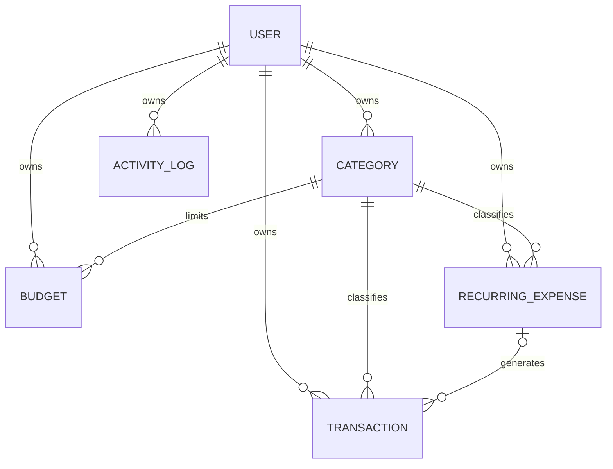

# Database schema

SQLite is accessed through SQLAlchemy. Each entity has an integer primary key `id`. User-owned records have a `user_id` foreign key; routes also enforce ownership explicitly. Foreign-key declarations describe relationships, while this beginner version relies on SQLAlchemy and application checks for deletion/tenant integrity rather than configuring SQLite foreign-key PRAGMAs or composite tenant constraints.

## `user`

| Column | Type | Purpose |
|---|---|---|
| id | Integer PK | Account identity |
| name | String(80), required | Display name |
| email | String(254), unique, required | Normalized lowercase login address |
| password_hash | String(255), required | Werkzeug salted password hash |
| currency | String(3), default INR | Display currency: INR/USD/EUR/GBP |
| session_token | String(64), unique, required | Random alternate ID for sessions and reset-token invalidation |
| failed_attempts | Integer, default 0 | Consecutive login failure counter |
| locked_until | DateTime, nullable | UTC lockout expiry |
| created_at | DateTime | Account creation in UTC |

Deleting a user through the app cascades to all their categories, transactions, budgets, recurring rules and activity logs through ORM relationships.

## `category`

| Column | Type | Purpose |
|---|---|---|
| id | Integer PK | Category identity |
| user_id | Integer FK → user.id, indexed | Owner |
| name | String(60), NOCASE | Category name |

Unique pair: `(user_id, name)`. SQLite NOCASE is case-insensitive for ASCII, not full Unicode. Deletion is blocked in the application while transactions, budgets or rules use this category.

## `transaction`

| Column | Type | Purpose |
|---|---|---|
| id | Integer PK | Transaction identity |
| user_id | Integer FK → user.id, indexed | Owner |
| category_id | Integer FK → category.id | Selected category |
| kind | String(10) | `income` or `expense` (database check) |
| amount_minor | BigInteger | Positive paise/cents; maximum 99,999,999,999 minor units |
| date | Date, indexed | Transaction's displayed calendar date |
| payment_method | String(20) | Validated payment method |
| notes | String(500) | Plain text, default empty |
| recurring_id | Integer FK → recurring_expense.id, nullable | Generating rule, if any |
| occurrence_date | Date, nullable | Original due date; remains stable if displayed date is edited |
| created_at | DateTime | Creation timestamp in UTC |

Unique pair: `(recurring_id, occurrence_date)`, protecting recurring occurrence identity. Multiple ordinary transactions can have NULL recurrence fields. Deleting a recurring rule detaches its transactions and preserves the history.

## `budget`

| Column | Type | Purpose |
|---|---|---|
| id | Integer PK | Budget identity |
| user_id | Integer FK → user.id, indexed | Owner |
| category_id | Integer FK → category.id | Limited category |
| month | Date | First day of the relevant month |
| amount_minor | BigInteger | Positive spending limit |

Unique triple: `(user_id, category_id, month)`. Spending is calculated from expense transactions in `[month, next_month)`; a redundant spent-total column is deliberately avoided.

## `recurring_expense`

| Column | Type | Purpose |
|---|---|---|
| id | Integer PK | Rule identity |
| user_id | Integer FK → user.id, indexed | Owner |
| category_id | Integer FK → category.id | Generated transaction category |
| amount_minor | BigInteger | Validated positive amount |
| payment_method | String(20) | Generated transaction payment method |
| notes | String(500) | Generated transaction notes |
| frequency | String(10) | weekly / monthly / yearly |
| next_due | Date | Next unprocessed scheduled date |
| anchor_day | Integer | Original intended day, for month-end/leap-year handling |
| active | Boolean, default true | Pause/resume flag |

Generation advances `next_due` with a conditional SQLAlchemy update and inserts its transaction in the same database transaction. Forms permit creation up to one year in the past and ten years ahead. Editing cannot rewind `next_due`.

## `activity_log`

| Column | Type | Purpose |
|---|---|---|
| id | Integer PK | Event identity |
| user_id | Integer FK → user.id, indexed | Owner |
| event | String(120) | Short event description |
| created_at | DateTime | Event time in UTC |

Contains account events, login successes/failures, record modifications, import/export and recurring processing. The profile displays the newest 100 events. Passwords, reset tokens and full financial notes are not written into this table.

## Why use minor units?

`120.50` becomes integer `12050`. Validation first parses a `Decimal`, then requires at most two decimal places. Integer addition is exact, unlike binary floating-point arithmetic. Chart.js receives major-unit numbers for display only; stored amounts and report calculations remain integers.

## Schema creation versus migration

`flask --app run init-db` uses `db.create_all()` to create absent tables. It does not alter existing tables after model changes. Add migrations before evolving a deployed database. Tests build a new temporary database for each test.
